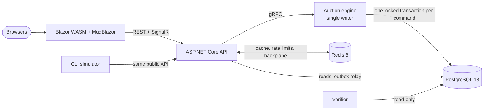

# Distributed Auction Platform

An eBay-style timed auction platform in .NET 10. Buy, Sell and Admin views stay consistent across many simultaneous users, and a load simulator with an independent verifier checks every auction's outcome afterwards.

## Status

Built bottom-up, one tested layer at a time ([build plan](docs/build-plan.md)).

| Layer | State |
|---|---|
| Toolchain and CI: pinned SDK, locked packages, zero-warning build, real-PostgreSQL tests | Built; CI green |
| Auction rules: money, proxy and fixed-increment bidding, reserve, deadlines, listing validation, lifecycle | Built and unit-tested (88 tests); database and service layers not yet built |
| Database, engine, API, UI, live updates, simulator | Not started |

The application can't be run yet. The one-command `docker compose up` arrives with build step 8.

## Architecture



- **One writer.** Only the engine changes auction state. A bid, any automatic proxy counter-bids, the auction update, the idempotency record and an outbox event commit in one transaction, under a row lock on the auction.
- **Database time decides deadlines.** The engine reads `clock_timestamp()` after taking the lock, so a bid that waited on the lock past the end is refused.
- **Live views without trusting the message.** An outbox relay sends SignalR change hints in commit order. Clients re-fetch authoritative state and ignore anything older than what they already show.
- **Redis helps but never decides.** With Redis down, bidding still works and the admin health panel shows what degraded.
- **An independent check.** After a simulator run, a separate verifier recomputes every auction from its bid history with a deliberately naive reference model and reports any disagreement.

## Run the tests

Prerequisites: .NET SDK 10.0.404 and Docker (the integration tests start PostgreSQL 18 through Testcontainers).

```bash
dotnet restore --locked-mode
dotnet build --no-restore -c Release
dotnet test --no-build -c Release
```

## Verification

- **Unit tests** for every auction rule. Each rejection is paired with a control case that must succeed.
- **Property tests** (CsCheck): each run generates 2,000 random auctions with random terms and bid sequences, and checks the rules against a separate naive reference model.
- **Planted-bug checks:** seven deliberate bugs planted in the rules during development were each caught by the suite.
- **Real infrastructure:** database tests run against PostgreSQL 18, never an in-memory provider.
- **CI** runs a locked restore, a format check, a zero-warning Release build and the full suite. It fails on any floating-point type in money code.
- **Independent requirements audits:** the latest one confirms the rules are correct at the unit layer. The requirements stay open until the database and service layers are built and tested.

## Repository layout

```
src/        application code (today: Auction.Domain)
tests/      unit, property and integration tests, and the reference model
docs/       requirements, architecture, build plan, decision records
deploy/     Docker Compose and the environment template
eng/        analyzer thresholds
```

## Documentation

| Document | What it covers |
|---|---|
| [Requirements](docs/requirements.md) | Requirements with acceptance criteria, domain rules, authorization table, targets, traceability |
| [Architecture](docs/architecture.md) | Components, the bid flow, engineering rules, design decisions, deployment |
| [Build plan](docs/build-plan.md) | Build order, dependencies, schedule and cut order |
| [User stories](docs/user-stories.md) | Stories for the Buy, Sell and Admin views |
| [Auction law and platform rules](docs/compliance.md) | What a real marketplace must do, and how this one handles each rule |
| [Decision records](docs/decisions/) | The significant decisions, with the alternatives considered |

## Known limitations

- Not a real marketplace: no payments, shipping or email.
- Only the auction rules are built so far; everything above them is planned in the build plan.

Items deliberately left out are listed in the [requirements](docs/requirements.md) §4 under Should, Could and Won't.
