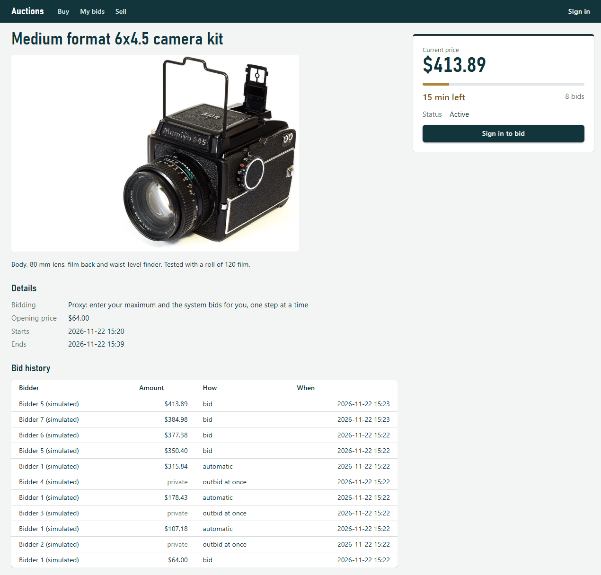
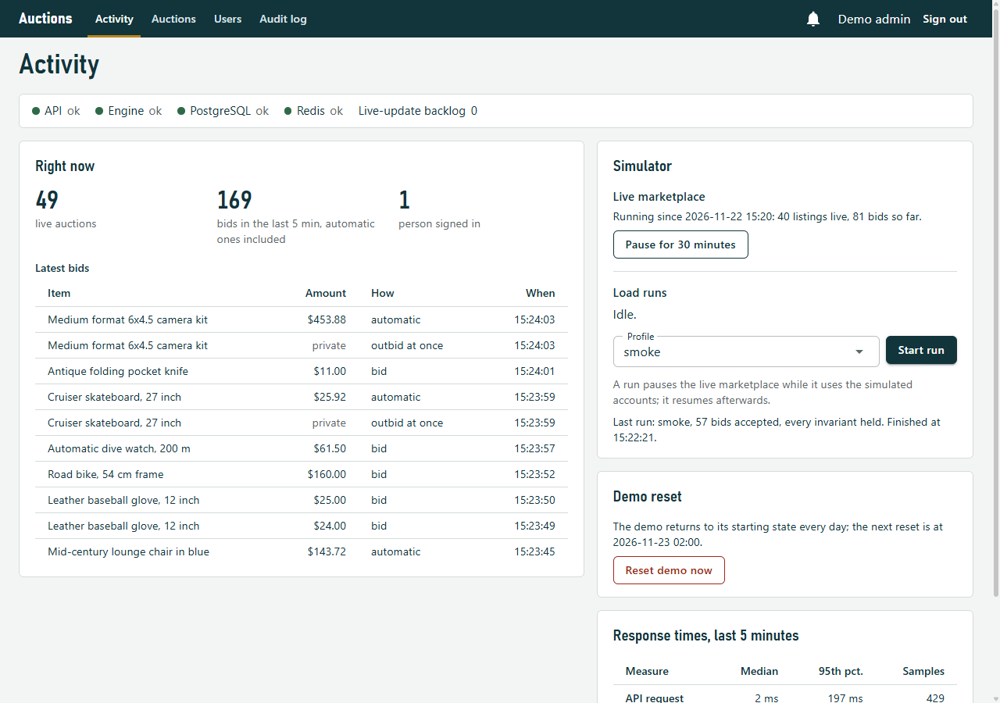
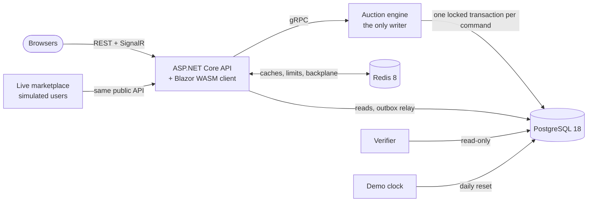

# Distributed Auction Platform

A timed, eBay-style auction platform in .NET 10. Many people can bid on the same item at the same moment, and everyone sees the same price within two seconds. The engine never loses a bid or sells an item twice.

**[Try the live demo →](https://auction.schnepel.cloud)** It's busy around the clock with simulated sellers and bidders, and resets itself every day.


| An auction with its bid history | The admin area |
|---|---|
|  |  |

- **One writer, no races.** A separate gRPC engine is the only service that changes auction state. Every bid is one locked PostgreSQL transaction, and 50 bidders hammering one auction break no rules.
- **Live in every browser.** A change reaches every open page within two seconds (outbox → Redis → SignalR), and pages heal on their own if Redis goes down.
- **A marketplace that runs itself.** Simulated sellers keep about 40 photographed listings live, simulated bidders bid on them, and an independent verifier recomputes every auction's result.
- **An admin area worth opening:** live activity, latency KPIs, moderation, user management, the simulator and an audit log.
- **500+ automated tests,** from unit and property tests to real browsers against the running containers. CI publishes signed images, and the demo deploys itself from `main`.

## Quick start

You need **Docker** with Compose v2 and **Git** (on Windows, use Git Bash or WSL).

```bash
git clone https://github.com/jschnepel/ebay.git
cd ebay
./run.sh
```

Then open **<http://localhost:8080>**. The first run takes a few minutes: it builds the images, generates every secret into `deploy/.env` (git-ignored), sets up the database and waits until every service is healthy. Stop it with `docker compose -f deploy/compose.yaml down`, adding `-v` to delete the data.

## A five-minute tour

1. **Look around.** The auctions page is already busy. Open one that's ending soon and watch its bid history grow.
2. **Bid.** Choose **Sign in → Create account → User**, then bid. Open a private window, create a second user and outbid yourself: both windows follow the price without a reload.
3. **Sell.** Under **Sell**, list something with a photo. Simulated bidders will find it.
4. **Run the site.** Sign out and create an account as **Admin**. **Overview** shows live bids and response times, the sidebar shows system health, and the simulator panel can pause the live marketplace or start a load run. **Auctions** lets you suspend or cancel a listing with a reason, and **Audit log** records it.
5. **Start over.** **Reset demo now** on the Activity page returns everything to its starting state, as happens every day at 09:00 UTC.

## System design



- **One writer.** Only the engine changes auction state. A bid, any automatic proxy counter-bids, the auction update and an outbox event commit together under a row lock on the auction.
- **The database clock decides deadlines.** The engine reads the time after it has the lock, so a bid that waited past the end is refused.
- **Pages never trust the message.** The outbox relay sends change hints in commit order; pages re-fetch the real state and ignore anything older than what they show.
- **Redis helps but never decides.** Without it, bidding still works and the admin health panel shows what degraded.
- **Least privilege.** Four database roles: the API can't write auction or bid tables, and the verifier can only read.
- **Checked from outside.** The verifier recomputes every auction from its bid history with a deliberately naive model that shares no code with the engine.

The [architecture](docs/architecture.md) covers the components, the bid flow, the data model and the decisions behind them.

## How the auctions work

- **Timed, rising-price, one item, US dollars,** in whole cents end to end.
- **Two settings per auction:** a price floor (hidden reserve, published minimum or none) and a bidding mode (proxy, where you set a private maximum and the system bids for you, or fixed steps).
- **Proxy price:** the highest maximum leads at the runner-up's maximum plus one step, never above its own maximum; equal maxima go to the earlier bid.
- **Fair endings:** terms freeze at publish, sellers can't bid on their own items, and bidders are anonymous in public histories.

The full rules, with their reasons, are in the [requirements](docs/requirements.md) §5 and the [compliance notes](docs/compliance.md).

## Quality

| Layer | What it proves |
|---|---|
| Unit and property tests | Every auction rule, with 2,000 random auctions per run checked against a naive reference model |
| Integration tests | The engine, API and roles against real PostgreSQL 18 and Redis 8, never in-memory stand-ins |
| Browser tests | Real journeys in Chromium, live prices across several browsers, accessibility checks and phone width |
| Container tests | The built images end to end: health, non-root users, restarts, redeploys, live prices, the live marketplace |
| Load and verification | 50 bidders on one auction, and every result recomputed by the verifier |

About 100 bugs were planted on purpose during development to prove the tests catch them; every one was caught. CI also runs a zero-warning build, secret and image scans, SBOMs with provenance, and a check that money never touches floating point. The full list is in the [architecture](docs/architecture.md#verification).

<details>
<summary><b>Run the tests yourself</b></summary>

You need the .NET SDK 10.0.404 and Docker; the integration tests start their own containers.

```bash
dotnet restore --locked-mode
dotnet build --no-restore -c Release
dotnet test --no-build -c Release
```

To test the built containers end to end on a throwaway stack (ports 9280–9282), run `sh eng/e2e.sh`. Add `E2E_KEEP=1` to leave it running afterwards.
</details>

<details>
<summary><b>More ways to run it</b></summary>

- **Other ports:** `PORT=9080 ./run.sh`, or set them in `deploy/.env`.
- **A load run from the command line:** `docker compose -f deploy/compose.yaml run --rm simulator run realistic`. The profiles are `smoke`, `realistic` and `hot-burst`, and the report includes the verifier's findings.
- **Reset to the seeded state:** `docker compose -f deploy/compose.yaml run --rm migrator reset-demo`.
- **Traces, metrics and logs:** `OTEL_EXPORTER_OTLP_ENDPOINT=http://aspire-dashboard:18889 docker compose -f deploy/compose.yaml --profile observability up -d`, then open <http://localhost:18888>.
- **Over plain HTTP:** [`Auction.Api.http`](src/Auction.Api/Auction.Api.http) walks the same journey.
</details>

## Deployment

The demo deploys itself. Once every CI check passes on `main`, CI publishes signed images. A timer on the host then pulls the newest passing commit, runs it, checks the public site, and rolls back by itself if anything fails. The [deployment view](docs/architecture.md#deployment-view) has the details, including hosting behind a reverse proxy or tunnel.

## Documentation

| Document | What it covers |
|---|---|
| [Requirements](docs/requirements.md) | Requirements with acceptance criteria, domain rules, authorization and traceability |
| [Architecture](docs/architecture.md) | Components, the bid flow, data model, engineering rules, verification and deployment |
| [Build plan](docs/build-plan.md) | Build order, what's built, and the cut order |
| [User stories](docs/user-stories.md) | Stories for the Buy, Sell and Admin views |
| [Auction law and platform rules](docs/compliance.md) | What a real marketplace must do, and how this one handles each rule |
| [Decision records](docs/decisions/) | The significant decisions and the alternatives considered |

```
src/      the engine, API, web client, migrator, simulator and verifier
tests/    unit, property, integration, browser and container tests
deploy/   Docker Compose, the environment template and the deploy script
docs/     the documents above
```

## Known limitations

- A demo, not a real marketplace: no payments, shipping or email.
- One API instance in Compose; Redis already shares live updates, limits and presence between instances.
- Without Redis, live updates pause (pages still refresh every 10 seconds) and rate limits count per instance.
- US dollars only; times show in the browser's time zone.

Items deliberately left out are listed in the [requirements](docs/requirements.md) §4.
