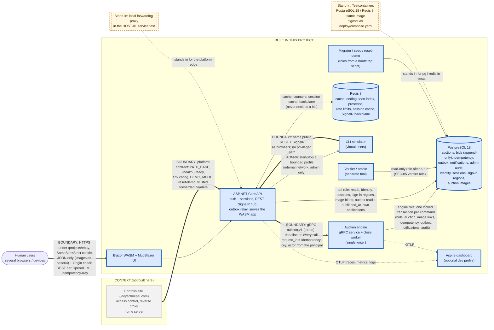
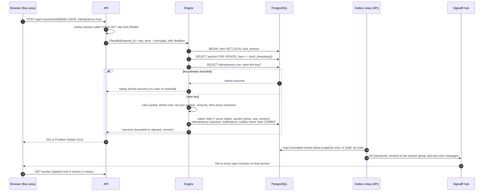
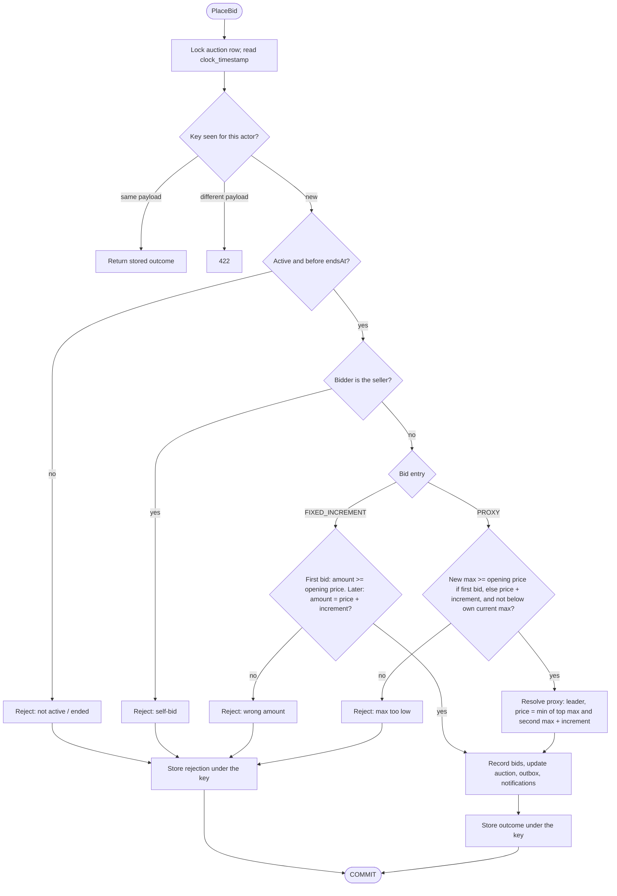

# Architecture

## Overview

A distributed ascending-price auction platform:

- **Blazor WebAssembly + MudBlazor frontend.** Calls an ASP.NET Core API over REST with cookie authentication.
- **ASP.NET Core API.** Forwards every auction command over gRPC to a separate **auction engine**, the only writer of auction state.
- **PostgreSQL** is the single source of truth. A bid (with any automatic proxy counter-bids), the auction update, the idempotency record, notifications and an outbox event commit in one transaction, under a row lock on the auction.
- **An outbox relay** in the API publishes those events, in commit order, as change hints through **SignalR**. Clients treat these as hints and re-fetch authoritative state, so a lost message never leaves a browser wrong for long.
- **Redis** does shared, non-authoritative work: a read cache, the "ending soon" index, presence and counters, rate limits, the session-validity cache, and the SignalR backplane for a second API instance. Bidding never depends on it.
- **A headless CLI simulator** drives realistic multi-user activity through the same public API. Afterwards, a separate verifier tool (the oracle) reads the database through a read-only role and checks every invariant. The simulator itself has no SQL access.

## Scope in context

Everything in blue is built in this project. Grey is context: the browsers, and the separate hosting platform that runs the live demo. Dashed amber is a stand-in used during the build.



**Stand-ins and compatibility checks for each boundary:**
- **Browser → web/API (REST):** no stand-in; service tests call the real API. The OpenAPI document is snapshot-checked in CI, so a contract change fails the build.
- **Simulator → API:** no stand-in; the simulator runs against the real stack in Compose, through the same public routes as browsers.
- **API → engine (gRPC):** no stand-in; service tests run both real services. The `.proto` files are checked for breaking changes in CI.
- **Platform → API:** see the forwarding-proxy stand-in below.
- **Testcontainers** uses the same digest-pinned images as `deploy/compose.yaml`; a version check runs in `PostgresEnvironmentTests`.
- **The forwarding proxy** runs in the HOST-01 service test, which checks forwarded headers and WebSocket pass-through. The real platform contract is verified when HOST-02 goes live.


## How a bid flows

The core consistency path. Every bid follows it, whichever UI or simulator sent it.



**Decision flow inside the engine for one bid:**



## Solution layout

```
src/
  Auction.Domain/      pure auction rules: money, bidding models, proxy resolution, lifecycle; no I/O and no clock: callers pass the database decision time
  Auction.Contracts/   auction.v1 .proto files (shared only as the contract)
  Auction.Engine/      gRPC service, close worker, raw Npgsql data access (single writer)
  Auction.Api/         minimal APIs in feature folders, auth + sessions, SignalR hub, outbox relay, Redis jobs; serves the WASM app
  Auction.Web/         Blazor WebAssembly + MudBlazor: Buy, Sell and Admin areas
  Auction.Migrator/    EF Core schema model and migrations (with triggers and grants), one-shot runner; later seed and reset-demo
  Auction.Simulator/   CLI virtual users over the public API
  Auction.Verifier/    read-only invariant checker using the reference model
tests/
  Auction.ReferenceModel/   naive auction rules shared by the verifier and property tests (no engine code)
  Auction.UnitTests/        domain rules + CsCheck property tests
  Auction.IntegrationTests/ real PostgreSQL / Redis (Testcontainers): engine transactions, roles, relay
  Auction.ServiceTests/     API + engine together over the real network boundary
  Auction.BrowserTests/     Playwright: Buy/Sell/Admin journeys, multi-browser consistency, axe
```

Projects are added as each build step needs them; today `Auction.Domain`, `Auction.Migrator`, `Auction.Engine` (its commands, not yet the gRPC host or close worker), the unit and integration tests and the reference model exist.

## Data model

All tables live in the `auction` schema, owned by the `migrator` role. Money is `bigint` cents from 1 to 1,000,000,000; times are `timestamptz`; ids are `uuid`. Enum-like columns are snake_case text with CHECK constraints. The model is in `src/Auction.Migrator/Schema`; triggers and grants are in `InitialSchemaSql.cs`.

| Table | Holds | Integrity in the database | Written by |
|---|---|---|---|
| `auctions` | Terms, status, current price, leader, bid count, version, outcome | Drafts may be incomplete; anything past draft must be a complete listing with a valid reserve. Terms are frozen after publish and only drafts can be deleted (triggers). A leader exists exactly when a bid has been accepted, and is never the seller | engine |
| `proxy_maxima` | Each bidder's private maximum and when it was accepted | Not readable by the `api` role, so a maximum can't leak through a read | engine |
| `bids` | The public accepted history, keyed `(auction_id, seq)`; an outbid-at-once step has no amount | Append-only: a trigger refuses UPDATE and DELETE, even for the owner. Rejected bids are recorded only as idempotency outcomes | engine |
| `idempotency_records` | Outcome per `(actor, key)` with a SHA-256 request hash; swept after 24 hours | | engine |
| `outbox_events` | Change events with the writing transaction's `xid8`, for the relay | The `api` role may only set `published_at` | engine; relay in the API |
| `notifications` | Outbid and closing notices per user | The `api` role may only set `read_at` | engine; read state by the API |
| `admin_audit` | Every admin action with its reason | | engine |
| `user_limits` | Per-user draft and publish counters, locked `FOR UPDATE` | | engine |

Identity, session and sign-in tables arrive with the API (steps 7 and 12), and image tables with step 13; each comes with its own grants and tests.

## Engineering rules

These hold across every component and are checked by tests.

- **Domain policies are binding** ([requirements](requirements.md) §5): money in integer cents; deadlines judged by database time under the auction lock; no self-bidding; terms frozen at publish; owner cancellation only before the first accepted bid.
- **The engine is the only writer of auction state.** The API has no write grant on auction or bid tables.
- **A bid, the auction update, the command result and the outbox event commit in one transaction.**
- **Actor identity always comes from the authenticated principal,** never from a request body.
- **SQL guarantees are proven against real PostgreSQL.** No in-memory database providers.
- **The simulator uses only the public API** (sign-in, REST, SignalR), with no SQL access or privileged path.
- **The verifier never references production rule code.** It and the property tests share a deliberately naive reference model.
- **Time:** stored and sent in UTC (`timestamptz`, ISO 8601), shown in local time only in the UI. Services take "now" from an injected `TimeProvider`; the domain takes the decision time as a parameter, and bid and close decisions use the database's `clock_timestamp()`.
- **Errors and logging:** structured JSON logs with a correlation ID on every line, each error logged once where it's handled, never secrets or email addresses. API errors are RFC 9457 Problem Details with no internals.
- **Configuration** is bound to typed options and validated at startup (`ValidateOnStart`), so a bad setting stops the process instead of failing later.
- **Async:** every I/O call takes a `CancellationToken`; background work runs only in hosted services with a bounded shutdown; no `async void` and no blocking on tasks (the threading analyzers enforce the last two).
- **Queries:** list endpoints are paginated with a maximum page size, and each has a query-count test so an N+1 regression fails the build.
- **Browser:** no tokens or secrets in `localStorage` or `sessionStorage`; the session lives only in the `HttpOnly` cookie.
- **Size:** method ≤ 60, class ≤ 500 and file ≤ 600 logical lines (checked in review); parameters ≤ 6, nesting ≤ 3 and cyclomatic complexity ≤ 15 (enforced by the analyzers).
- **Reuse:** shared logic lives in one place in the solution; duplicate code is extracted on the second copy.

## Design decisions

The main choices, with the alternatives considered. Requirement IDs refer to [requirements.md](requirements.md).

| Area | Choice | Alternatives considered | Why |
|---|---|---|---|
| Auction style | Timed, eBay-style auctions with a fixed end time | Live, auctioneer-paced auctions | Fits a multi-user web demo and an automated simulator |
| Concurrency on one auction | Pessimistic row lock (`SELECT … FOR UPDATE`) under READ COMMITTED, with `SET LOCAL lock_timeout`; one or two jittered retries on deadlock or lock timeout | Optimistic version check; SERIALIZABLE; advisory locks; an in-memory actor per auction | Correct on any number of engine instances, and other auctions are unaffected. Optimistic schemes turn a hot auction into a retry storm. The actor model is the scale-out path, described rather than built |
| Data access | Raw Npgsql (`NpgsqlBatch`, one per command) on the engine's bid and close paths; EF Core for migrations and ordinary reads | EF Core everywhere; Dapper | The bid transaction stays explicit and holds the lock as briefly as possible. EF Core can't express `FOR UPDATE` or `clock_timestamp()` without raw SQL anyway |
| Database roles | A bootstrap script creates four login roles; the unprivileged migrator owns the schema and issues grants. The API has no write grant on auctions or bids; bids are INSERT-only with a trigger blocking UPDATE and DELETE | One application role | The database itself enforces the single-writer rule and append-only history (SEC-05) |
| Idempotency | Key stored in the engine's transaction, keyed by `(actor, key)` with a request hash and the recorded outcome, rejections included. Missing key: 400; same key, different payload: 422. Checked after the auction lock, so a racing duplicate waits and replays | 409 on a concurrent duplicate | Follows the IETF Idempotency-Key draft; a timeout after commit is always safe to retry |
| Outbox relay | The engine writes outbox rows in the bid transaction. One relay in the API reads only rows below the current snapshot's `xmin`, in `(xid8, id)` order; `LISTEN/NOTIFY` is only a wake-up | Multi-worker `SKIP LOCKED`; Debezium; a messaging library | A plain sequence can be skipped when a lower id commits late; the snapshot rule prevents that. Multi-worker claims lose per-auction ordering |
| CSRF | `SameSite=Strict` cookie, JSON-only unsafe endpoints, `Origin` check; no antiforgery tokens | Antiforgery tokens | Same-origin JSON API; see [ADR-0003](decisions/0003-same-origin-csrf-model.md) |
| One session per account | Server-side sessions table; the cookie carries a session id checked per request with a short cache. A new sign-in revokes older sessions and tells their open pages over SignalR | Identity security-stamp rotation | Immediate revocation with a live notice; security stamps are checked only every 30 minutes |
| Redis | A read cache, the "ending soon" index, presence and counters, shared rate limits, the session-validity cache, and the SignalR backplane. Never decides a bid; with Redis down, bidding still works and the admin panel shows the degradation | Redis configured but idle; two API instances from day one | Gives Redis real work without trusting it with money or winners |
| Latency KPIs | Exact p50/p95 from an in-process ring of 300 one-second slots, unit-tested with a fake clock; also exported as an OpenTelemetry histogram | Histogram only; Prometheus | Exact and testable. Default histogram buckets would put every sub-second value in one bucket |
| Observability | OpenTelemetry over OTLP to the standalone Aspire dashboard in an optional Compose profile | Aspire AppHost; Prometheus and Grafana | No extra stack; Compose stays the source of truth |
| Container images | Multi-stage Dockerfiles onto chiseled, non-root runtime images, with a health probe built into each binary | SDK container publishing | Small, non-root images; chiseled images have no shell for `curl` probes |
| Verifier independence | A deliberately naive reference model of the rules, shared by the verifier and the property tests, never referencing engine code | Separate checks per tool | One independent oracle used at three scales: unit, property and full simulator run |
| Supply chain | Locked restore, NuGetAudit failing on any advisory, SHA-pinned actions, one Trivy image scan, build provenance and SBOM attestations, Dependabot | Full SLSA L3 | Most of the value for little time |
| Hosting | Served behind the portfolio site's reverse proxy under a configurable path base (`PATH_BASE`), with a path-scoped cookie and forwarded headers trusted only from that proxy | A tunnel or an open port with its own login | The platform already provides TLS and access control |
| Identifiers | Typed `AuctionId` and `UserId` (record structs over time-ordered version 7 GUIDs), stored as `uuid` | Plain `Guid`; database sequences | The compiler catches a user id passed as an auction id; version 7 ids keep index inserts local, and ids can be made before the row exists, which idempotent creates need |
| Image storage | PostgreSQL `bytea`, content-addressed per owner, written by the API; links from auctions to images written only by the engine under the auction lock | A disk volume; S3-compatible storage | No extra service, and the engine stays the single writer, so the four-image cap and the publish freeze can't race |

## Dependencies

Each package is pinned in `Directory.Packages.props` and locked by the lock files. Analyzers and test packages never ship with the application.

| Package | Purpose | Licence |
|---|---|---|
| Npgsql | PostgreSQL driver | PostgreSQL |
| Npgsql.EntityFrameworkCore.PostgreSQL, Microsoft.EntityFrameworkCore.Relational | Schema model and migrations | PostgreSQL, MIT |
| Microsoft.EntityFrameworkCore.Design, dotnet-ef | Generating migrations (development only) | MIT |
| Microsoft.Extensions.Logging.Console | JSON console logs | MIT |
| SonarAnalyzer.CSharp | Size, nesting and code-smell analyzers (build only) | Sonar Source-Available |
| Microsoft.VisualStudio.Threading.Analyzers | Async misuse analyzers (build only) | MIT |
| xunit.v3 | Test framework | Apache-2.0 |
| CsCheck | Property-based tests | Apache-2.0 |
| Testcontainers.PostgreSql | Real PostgreSQL in integration tests | MIT |
| Microsoft.Testing.Extensions.TrxReport | Test result files for CI | MIT |
| Microsoft.Testing.Extensions.CodeCoverage | Line coverage for the CI floor | Microsoft .NET Library licence |

## Deployment view

- **Local / review:** `docker compose -f deploy/compose.yaml up` runs all services on one host. Infrastructure ports bind to 127.0.0.1 only.
- **Live (HOST-02, Should):** the same containers on a home server behind the portfolio site's reverse proxy; TLS terminates at that proxy.

**Hosting requirements (HOST-01):**
- `/health` (liveness, no dependencies) and `/ready` (engine and database).
- All configuration through environment variables, documented in `deploy/.env.example`.
- `DEMO_MODE=true` turns on self-registration with email-only sign-in; nothing in scope has external side effects.
- An idempotent `reset-demo` command reseeds demo users and auctions; the hosted copy runs it nightly.
- Works behind a reverse proxy (forwarded headers, WebSocket pass-through) under a configurable path base (`PATH_BASE`) with a path-scoped, app-specific cookie. TLS terminates at the proxy.
- Demo passwords are generated at deploy time and never committed.
- **Designed for cloud (not built):**

  | Component | Azure (chosen for this design) | AWS equivalent | Google Cloud equivalent |
  |---|---|---|---|
  | API and engine | Azure Container Apps | ECS on Fargate | Cloud Run |
  | Database | Azure Database for PostgreSQL | RDS PostgreSQL | Cloud SQL |
  | Backplane | Azure Cache for Redis | ElastiCache | Memorystore |

  Infrastructure would be defined in Terraform. Kubernetes isn't justified at this scale.
