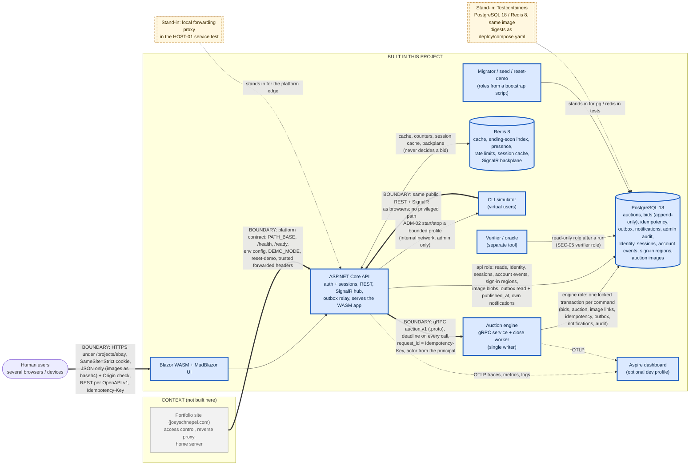
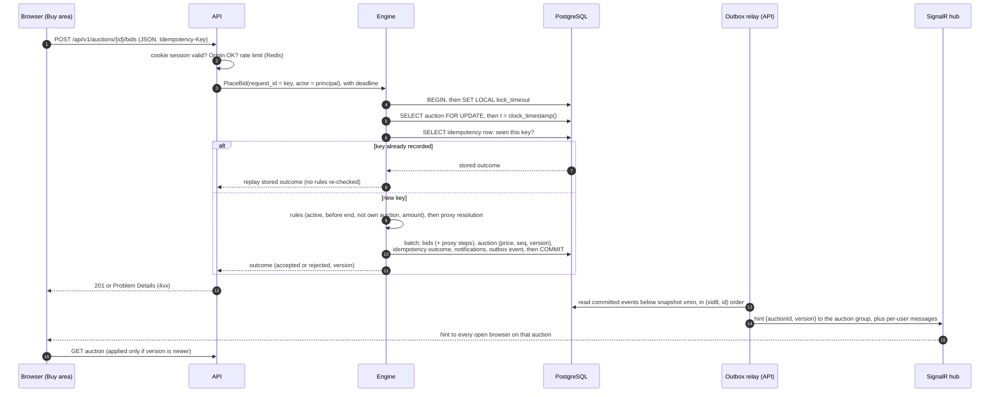

# Architecture

## Overview

A distributed ascending-price auction platform:

- **Blazor WebAssembly + MudBlazor frontend.** Calls an ASP.NET Core API over REST with cookie authentication.
- **ASP.NET Core API.** Forwards every auction command over gRPC to a separate **auction engine**, the only writer of auction state.
- **PostgreSQL** is the single source of truth. A bid (with any automatic proxy counter-bids), the auction update, the idempotency record, notifications and an outbox event commit in one transaction, under a row lock on the auction.
- **An outbox relay** in the API publishes those events, in commit order, as change hints through **SignalR**. Clients treat these as hints and re-fetch authoritative state, so a lost message never leaves a browser wrong for long.
- **Redis** does shared, non-authoritative work: a read cache, the "ending soon" index, presence and counters, rate limits, the session-validity cache, and the SignalR backplane for a second API instance. Bidding never depends on it.
- **A headless CLI simulator** drives realistic multi-user activity through the same public API. Afterwards, a separate verifier tool (the oracle) reads the database through a read-only role and checks every invariant. The simulator's traffic never touches SQL; its closing check calls the verifier, which reads only as the read-only `verifier` role.

## Scope in context

Everything in blue is built in this project. Grey is context: the browsers, and the separate hosting platform that runs the live demo. Dashed amber is a stand-in used during the build.



**Stand-ins and compatibility checks for each boundary:**
- **Browser → web/API (REST):** no stand-in; service tests call the real API. The OpenAPI document is snapshot-checked in CI, so a contract change fails the build.
- **Simulator → API:** no stand-in; the simulator runs against the real stack in Compose, through the same public routes as browsers.
- **API → engine (gRPC):** no stand-in; service tests run both real services. The `.proto` files are checked for breaking changes in CI.
- **Platform → API:** see the forwarding-proxy stand-in below.
- **Testcontainers** uses the same digest-pinned images as `deploy/compose.yaml`; a version check runs in `PostgresEnvironmentTests`.
- **The forwarding proxy** runs in the HOST-01 service test, which checks forwarded headers and WebSocket pass-through. The real platform contract is verified when HOST-02 goes live.


## How a bid flows

The core consistency path. Every bid follows it, whichever UI or simulator sent it.



**Decision flow inside the engine for one bid:**


## HTTP API

Everything under `/api/v1`, JSON only, documented at `/openapi/v1.json`. Errors are Problem Details with a stable `code`. Commands need an `Idempotency-Key` header; reads are anonymous, except that a draft exists only for its seller.

| Route | What it does |
|---|---|
| `POST /account/sign-up`, `POST /account/sign-in`, `POST /account/sign-out`, `GET /account/me` | Accounts and the session cookie (AUTH-01) |
| `GET /auctions?q&status&pageSize&cursor` | Published auctions, ending soonest first, keyset-paginated; `q` searches titles (its wildcards taken literally), `status` is `active`, `ending_soon` (active and ending within the hour) or `closed` |
| `GET /auctions/{id}`, `GET /auctions/{id}/bids` | One auction as the viewer may see it, with whether they lead it and whether they have bid on it; its bid history with anonymous labels. An id a demo reset cleared is `410 removed` ("This auction has ended…"), not a 404 |
| `POST /auctions`, `PUT /auctions/{id}` | Create or edit a draft (every term required) |
| `POST /auctions/{id}/publish`, `/cancel`, `/bids` | Publish, cancel, bid: forwarded to the engine with the signed-in user as the actor |
| `GET /me/auctions`, `GET /me/bids` | The signed-in user's own auctions (drafts included), and the auctions they bid on with whether they lead |
| `DELETE /auctions/{id}` | The owner deletes a draft (a published auction can only be cancelled) |
| `GET /admin/activity`, `/admin/health`, `/admin/kpis` | Admin only: live activity, component health with the live-update backlog, latency KPIs |
| `GET /admin/auctions?q&status`, `POST /admin/auctions/{id}/suspend`, `/resume`, `/cancel` | Admin only: published auctions (never drafts) searched by title, seller name or id; moderation through the engine with a required reason |
| `GET /admin/users/{id}`, `/admin/users/{id}/listings`, `/admin/users/{id}/bidding` | Admin only: one user's profile and counts, their published auctions, and the auctions they've bid on with their standing, newest first |
| `GET /admin/events?from&to&category&q&user`, `GET /admin/events/histogram` | Admin only: the event log, merged newest first from account events, the admin audit, demo resets, listings and bids, cursor-paged by time and a unique key; and its counts per category per time bucket |
| `GET /admin/users?q&kind&state`, `POST /admin/users/{id}/disable`, `/enable` | Admin only: accounts by name, email or id, filtered by kind and state, with last sign-in and activity counts; disabling ends the account's session on its next request |
| `GET /me/notifications`, `POST /me/notifications/{id}/read` | The signed-in user's own notifications, newest first, with the unread count |
| `POST /images`, `GET /images/{id}` | Upload an image as base64 inside JSON (type from its own bytes, at most 5 MiB, the request at most 8 MiB); serve it with its validated type, an ETag, and `public, immutable` once published or `private, no-store` while a draft's (other viewers get 404) |
| `POST /auctions/{id}/images`, `DELETE /auctions/{id}/images/{imageId}`, `PUT /auctions/{id}/images`, `POST /auctions/{id}/images/{imageId}/cover` | The seller's draft images through the engine: attach, remove, reorder, choose the cover |
| `/hubs/auctions` (SignalR) | Live change hints `{auctionId, version}`: `Watch(id)` for one auction, `WatchDirectory()` for every published change |

**Images.** Uploading and linking are separate so the engine stays the only writer of auction state. The API stores an upload as a blob owned by the uploader, keyed by its SHA-256 per owner so a retry returns the same blob, after locking the uploader's quota row and then the single global quota row `FOR UPDATE`: the hourly upload limit, the per-user 100 MiB and the 2 GiB total can't be overshot by racing uploads. The engine links blobs to a draft under the auction lock, checking the draft is the caller's, the blob is the caller's and the four-image cap; publishing takes the same lock, so an attach lands before it or is refused, and a trigger freezes the links of a published auction for every role except the schema owner. A link's foreign key to its blob is `ON DELETE RESTRICT`, so the hourly sweep of blobs left unattached for an hour can't remove one that an attach is linking. The same per-seller limits row, locked `FOR UPDATE`, counts open drafts (at most 10) and the day's publishes (at most 20).

**Redis jobs.** One connection, with short timeouts, for work that helps but never decides; every caller treats a Redis failure as a miss. (1) A read cache for published auctions: the relay, and the API itself as soon as the engine accepts a command, announce each auction's new version before anyone can hear of it; a cached entry older than the announced version is ignored and dropped, and a fill can only store a version at least as new, so a cached page is never older than a change that has been announced or confirmed to its author. The directory's first page is cached per generation, and every announced change starts a new one. Drafts are never cached. (2) The session-validity cache, a minute long; every revocation deletes its entry in the same step. Whether a viewer has bid on an auction is remembered the same way (a yes for ten minutes, a no for one), and the API records each bid it accepts, so the auction page asks PostgreSQL once and not on every refresh. (3) Fixed-window rate-limit counters shared across instances, falling back to per-instance counters; writes and reads are counted apart (300 and 1,200 a minute for each user), so the polling admin pages can't use up the limit on an admin's own actions. (4) Presence: each instance keeps its signed-in connections in a shared sorted set with a heartbeat. (5) The SignalR backplane. The "ending soon" filter is a PostgreSQL query on the `(status, ends_at)` index rather than a Redis index.

**Admin.** Every admin route answers 404 to anyone else, so its existence isn't revealed. Suspend, resume and cancel are engine commands like any other: under the auction lock, idempotent, with an audit row and notifications to the seller and bidders in the same transaction. Disabling a user is the API's own write (it may set only `disabled_at`), audited in the same statement; every signed-in request checks the account is still enabled. The latency KPIs are measured in process into rolling 300 × 1-second windows (exact nearest-rank p50 and p95, "not measured" when empty) and .NET metrics histograms: API request time, bid time from receipt to response, engine call time, and publish lag from the event's transaction to its hint being sent.

**Sessions and limits.** The cookie carries a server-side session id. Signing in starts a session and revokes the account's others in one transaction, and the hub tells their open pages at once; every signed-in request checks its session is live and its account enabled, so a revoked or copied cookie fails on its next request. Sign-up is limited per client address (20 an hour), sign-in per address (60 a minute) and per account (10 a minute, with a five-minute lockout after five wrong passwords), and every write per user (300 a minute), each answered with 429 and `Retry-After`. All limits are configuration. These counters are per instance until step 14 moves them to Redis.

**Live updates.** The engine writes an outbox row in each command's transaction; a statement trigger sends a `NOTIFY` at commit, purely as a wake-up. One relay runs across all API instances (it holds a PostgreSQL advisory lock): it reads unpublished rows below the current snapshot's `xmin`, ordered by `(xid, id)`, so a transaction that commits late holds back later events instead of being skipped; sends each as a hint through the Redis backplane; then stamps `published_at`. A send that fails leaves the row for the next try, and duplicates are harmless. Hints carry no private data and drafts produce none. A connection from a signed-in browser also joins its user's and its session's groups: the relay tells each user whose notifications a change created to refresh the bell, and a sign-in elsewhere tells the ended session. The client re-fetches over REST on a newer hint, every 10 s, when the tab becomes visible and after a reconnect, and never replaces a version it shows with an older one. The hub's `Origin` is checked on every method, since its WebSocket handshake is a GET.

The same host serves the Blazor WebAssembly client: its files through static assets, and its page for every other non-API path, so a deep link such as `/auctions/{id}` loads the app. An unknown `/api` path is a 404 problem, never the page. Every response carries a content security policy (scripts from this origin only, with `'wasm-unsafe-eval'` for WebAssembly; `connect-src 'self'`; no framing), `nosniff` and `Referrer-Policy: same-origin`.

## Solution layout

```
src/
  Auction.Domain/      pure auction rules: money, bidding models, proxy resolution, lifecycle; no I/O and no clock: callers pass the database decision time
  Auction.Contracts/   auction.v1 .proto files (shared only as the contract)
  Auction.Engine/      gRPC service, close worker, raw Npgsql data access (single writer)
  Auction.Api/         minimal APIs in feature folders, auth + sessions, SignalR hub, outbox relay, Redis jobs; serves the WASM app
  Auction.Web/         Blazor WebAssembly + MudBlazor: Buy, Sell and Admin areas
  Auction.Migrator/    EF Core schema model and migrations (with triggers and grants), one-shot runner, demo seed; later reset-demo
  Auction.Simulator/   CLI virtual users over the public API (smoke, realistic, hot-burst), then the verifier; `serve` runs the admin area's control endpoint
                       and, in the demo, the always-on live marketplace (Live/, with its photo catalogue in Catalogue/)
  Auction.Verifier/    read-only invariant checker using the reference model
tests/
  Auction.ReferenceModel/   naive auction rules shared by the verifier and property tests (no engine code)
  Auction.UnitTests/        domain rules + CsCheck property tests
  Auction.IntegrationTests/ real PostgreSQL / Redis (Testcontainers): engine transactions, roles, relay, the
                            API in process calling the engine container over gRPC, and Playwright browser
                            journeys (Browser/) against the same fixtures, or against a running stack when
                            AUCTION_BASE_URL is set
  Auction.StackTests/       the containers end to end, from outside only (published port, browser, Docker
                            CLI); eng/e2e.sh starts a throwaway Compose project for them and removes it
```

Projects are added as each build step needs them; today `Auction.Domain`, `Auction.Migrator`, `Auction.Contracts`, `Auction.Engine` (gRPC service and close worker), `Auction.Api`, `Auction.Web`, `Auction.Simulator`, `Auction.Verifier`, the unit and integration tests and the reference model exist. The browser tests live in the integration test project so they share its database and engine fixtures.

## Data model

All tables live in the `auction` schema, owned by the `migrator` role. Money is `bigint` cents from 1 to 1,000,000,000; times are `timestamptz`; ids are `uuid`. Enum-like columns are snake_case text with CHECK constraints. The model is in `src/Auction.Migrator/Schema`; triggers and grants are in `InitialSchemaSql.cs`.

| Table | Holds | Integrity in the database | Written by |
|---|---|---|---|
| `auctions` | Terms, status, current price, leader, bid count, version, outcome | A draft has every term but may still break the listing rules (a short title, a missing reserve); anything past draft must be a valid listing with a valid reserve. Terms are frozen after publish and only drafts can be deleted (triggers). A leader exists exactly when a bid has been accepted, and is never the seller | engine |
| `proxy_maxima` | Each bidder's private maximum and when it was accepted | Not readable by the `api` role, so a maximum can't leak through a read | engine |
| `bids` | The public accepted history, keyed `(auction_id, seq)`; an outbid-at-once step has no amount | Append-only: a trigger refuses UPDATE and DELETE, even for the owner. Rejected bids are recorded only as idempotency outcomes | engine |
| `idempotency_records` | Outcome per `(actor, key)` with a SHA-256 request hash; the close worker deletes records older than 24 hours, hourly | | engine |
| `outbox_events` | Change events with the writing transaction's `xid8`, for the relay | The `api` role may only set `published_at` | engine; relay in the API |
| `notifications` | Outbid and closing notices per user | The `api` role may only set `read_at` | engine; read state by the API |
| `admin_audit` | Every admin action with its reason | | engine |
| `account_events` | Sign-ups, sign-ins, failed sign-ins and their cause, sign-outs and ended sessions, with the account and the email typed (only for a known account, or text shaped like a plain address); never a password field, IP or user agent. A write that fails is logged and dropped rather than failing the sign-in | Append-only: a trigger refuses UPDATE and DELETE, even for the owner; the `api` role can't set the id or the time. Only the demo reset empties it: at most 60 failed sign-ins a minute per address are written, and a deployment outside the demo would need a retention job first | API |
| `user_limits` | Per-user draft and publish counters, locked `FOR UPDATE` | | engine |
| `users` | Accounts: display name, email, kind (self-registered, visitor admin, seeded, simulator, admin), password hash | Email unique ignoring letter case; every kind but the two visitors create (self-registered and visitor admin, demo only) must have a password hash. Only the `api` role can read it, so no other role sees an email | api (insert only) |
| `demo_resets` | Demo resets (ADM-04): requested (by an admin's display name, cleared when done) or scheduled, and when each completed | At most one waits at a time (a partial unique index); the `api` role may only insert a request and read | migrator (the demo-clock) |

Session tables arrive with step 12 and image tables with step 13; each comes with its own grants and tests.

**The event log reads where events already live.** Only account activity gets a table of its own (`account_events`, written by the API). Bids, listings and admin actions are read from `bids`, `auctions`, `outbox_events` (for a seller's cancellation), `admin_audit` and `demo_resets` and merged in one bounded `UNION ALL`, so the engine and the bid path write nothing extra. Each source is cut to the requested range and the page's cursor (a time and a unique key such as `b:<auction>:<seq>`), filtered, and limited to one page of its own newest rows before the page is taken from them, so a page never carries more than a page from any source. The chart's counts do read the whole range; live mode redraws it every 30 seconds. `bids` has an ordered index on its time so the newest page is read without touching the rest of the range; bids arrive in time order, so each insert lands on the index's last page. `outbox_events` indexes only the cancellation rows the log reads, which a bid's insert never touches.

## Engineering rules

These hold across every component and are checked by tests.

- **Domain policies are binding** ([requirements](requirements.md) §5): money in integer cents; deadlines judged by database time under the auction lock; no self-bidding; terms frozen at publish; owner cancellation only before the first accepted bid.
- **The engine is the only writer of auction state.** The API has no write grant on auction or bid tables.
- **A bid, the auction update, the command result and the outbox event commit in one transaction.**
- **Actor identity always comes from the authenticated principal,** never from a request body.
- **SQL guarantees are proven against real PostgreSQL.** No in-memory database providers.
- **The simulator's traffic uses only the public API** (password sign-in, REST), with no privileged path. Its closing check runs the verifier, whose only database access is the read-only `verifier` role.
- **The verifier never references production rule code.** It and the property tests share a deliberately naive reference model.
- **Time:** stored and sent in UTC (`timestamptz`, ISO 8601), shown in local time only in the UI. Services take "now" from an injected `TimeProvider`; the domain takes the decision time as a parameter, and bid and close decisions use the database's `clock_timestamp()`.
- **Errors and logging:** structured JSON logs with a correlation ID on every line, each error logged once where it's handled, never secrets or email addresses. API errors are RFC 9457 Problem Details with no internals.
- **Configuration** is bound to typed options and validated at startup (`ValidateOnStart`), so a bad setting stops the process instead of failing later.
- **Async:** every I/O call takes a `CancellationToken`; background work runs only in hosted services with a bounded shutdown; no `async void` and no blocking on tasks (the threading analyzers enforce the last two).
- **Queries:** list endpoints are paginated with a maximum page size, and each has a query-count test so an N+1 regression fails the build.
- **Browser:** no tokens or secrets in `localStorage` or `sessionStorage`; the session lives only in the `HttpOnly` cookie.
- **Size:** method ≤ 60, class ≤ 500 and file ≤ 600 logical lines (checked in review); parameters ≤ 6, nesting ≤ 3 and cyclomatic complexity ≤ 15 (enforced by the analyzers).
- **Reuse:** shared logic lives in one place in the solution; duplicate code is extracted on the second copy.

## Verification

How the rules above, and the requirements, are shown to hold.

- **Unit tests** for every auction rule. Each rejection is paired with a control case that must succeed.
- **Property tests** (CsCheck): each run generates 2,000 random auctions with random terms and bid sequences, and checks the rules against a separate naive reference model.
- **Planted-bug checks:** deliberate bugs planted during development were each caught by the suite: seven in the rules, three in the database triggers and grants, and five in the engine (no row lock, the clock read before the lock wait, a private amount written to the history, a close worker that skips the lock, and one that closes early), two in the gRPC mapping, and six more for idempotency, draft privacy, event payloads and grants (an idempotency key that ignores a clash on another auction, other users' drafts made visible, a bidder id in an event, a sweep that deletes fresh keys, a worker that never sweeps, and over-granted roles), and ten in the API (a foreign origin or a form post accepted, the reserve shown to everyone, drafts readable by anyone, email-only sign-in for password accounts, ownership revealed with 403, an uncapped page size, an extra query per page, a `SameSite=Lax` cookie, and an admin allowed to sell), and eight for the web client and seed (another seller's auctions in "my auctions", every bid shown as leading, a minimum bid without the increment, a page that may be framed, the app's page served for an unknown API path, a seed that resets passwords, the opening price shown after a bid, and a repeated sign-up not offered the existing account), and seven for live updates (a relay that ignores the snapshot horizon or waits only for NOTIFY, a hub whose WebSocket handshake skips the Origin check, an auction page or directory that ignores hints, no periodic reconcile, and an older answer replacing a newer one). Four more for the simulator and verifier: an engine with the auction row lock removed (the 50-bidder hot burst exposes it), a verifier that skips the standing or the visible-price check, and a run that passes without a clean verifier report. Seven for the admin area: admin routes open to any signed-in user, moderation without an audit row, an outbid notice sent to the new leader, a disabled user keeping their session, a KPI window one second too long, drafts in the moderation list, and the Sell area shown to admins. Eight for accounts and notices: a sign-in that leaves other sessions alive, a sign-out that only drops the cookie, revoked sessions still accepted, anyone marking any notification read, a bell never told, writes without a rate limit, no lockout after wrong passwords, and an open page that ignores the sign-out message. Eight for images: an upload that trusts the claimed type, an attach that ignores who owns the blob, a fifth image allowed, draft images cached publicly, a quota checked without its row lock, a sweep that ignores links, a 21st publish in a day, and published images not frozen in the database. Six for the Redis jobs: no version announce when a command is accepted (exposed by holding the relay back), a revoked session left in the cache, limits and presence counted per instance only, an "ending soon" filter without its window, and a sign-in that fails while Redis is down. Four for the design: an error with no way to retry, a bell button with no accessible name (axe), cards too wide for a phone, and drafts that can't be deleted. Five for hosting: readiness that ignores the engine, forwarded headers believed from anyone, a reset that keeps visitors' accounts, a page base that ignores the path base, and a cookie scoped to the whole host. Eight for the admin simulator control, the audit log and telemetry: an API that sends the engine no trace context, a control endpoint that accepts any token, a demo that allows the hot burst, simulator starts and stops left out of the audit, an audit log listed oldest first, an engine command without its transaction span, a publish batch without its span, and telemetry that is never exported. Five for the demo reset and the live controls: a reset that leaves sessions cached in Redis, a fresh install that resets at once, a reset reachable outside the demo, a reset sent without its confirmation, and live-marketplace pauses left out of the audit.
- **Real infrastructure:** database tests run against PostgreSQL 18, never an in-memory provider.
- **Browser tests** (Playwright, headless Chromium): a seller lists and publishes, a buyer bids, and both see the new price after a reload, in the in-process site and again against the one-command Compose stack.
- **End-to-end tests of the containers** (`eng/e2e.sh`), with no project references, only the published port, a browser and the Docker CLI: every service healthy and the migrator exited cleanly, no application container running as root, every long-running service set to restart with Docker, only the API and the data stores publishing ports and only on 127.0.0.1, a replaced API container that keeps people signed in and their listings, bids accepted after the engine restarts, live prices in three browsers within 2 s, moderation by the seeded admin with its audit row, and a smoke run from the admin page that the verifier passes.
- **CI** runs a locked restore, a format check, a zero-warning Release build, the one command on the fresh clone, the full suite, the browser journey against that stack and the end-to-end tests of the containers, and lints the gRPC contract (with a breaking-change check on pull requests). It fails on any floating-point type in money code. A supply-chain job scans the whole history for secrets (gitleaks), scans every image for fixable critical vulnerabilities (Trivy), writes SPDX SBOMs and, on `main`, attests their provenance; Dependabot proposes updates weekly.

## Design decisions

The main choices, with the alternatives considered. Requirement IDs refer to [requirements.md](requirements.md).

| Area | Choice | Alternatives considered | Why |
|---|---|---|---|
| Auction style | Timed, eBay-style auctions with a fixed end time | Live, auctioneer-paced auctions | Fits a multi-user web demo and an automated simulator |
| Concurrency on one auction | Pessimistic row lock (`SELECT … FOR UPDATE`) under READ COMMITTED, with `SET LOCAL lock_timeout`; one or two jittered retries on deadlock or lock timeout | Optimistic version check; SERIALIZABLE; advisory locks; an in-memory actor per auction | Correct on any number of engine instances, and other auctions are unaffected. Optimistic schemes turn a hot auction into a retry storm. The actor model is the scale-out path, described rather than built |
| Data access | Raw Npgsql everywhere at run time: one `NpgsqlBatch` per engine command, and one fixed query per API read; EF Core only to model the schema and generate migrations | EF Core everywhere; Dapper | The bid transaction stays explicit and holds the lock as briefly as possible. EF Core can't express `FOR UPDATE` or `clock_timestamp()` without raw SQL anyway, and the API's reads are a few hand-written queries whose count a test pins |
| Database roles | A bootstrap script creates four login roles; the unprivileged migrator owns the schema and issues grants. The API has no write grant on auctions or bids; bids are INSERT-only with a trigger blocking UPDATE and DELETE | One application role | The database itself enforces the single-writer rule and append-only history (SEC-05) |
| Idempotency | Key stored in the engine's transaction, keyed by `(actor, key)` with a request hash and the recorded outcome, rejections included. Missing key: 400; same key, different payload: 422. Checked after the auction lock, so a racing duplicate waits and replays | 409 on a concurrent duplicate | Follows the IETF Idempotency-Key draft; a timeout after commit is always safe to retry |
| Outbox relay | The engine writes outbox rows in the bid transaction. One relay in the API reads only rows below the current snapshot's `xmin`, in `(xid8, id)` order; `LISTEN/NOTIFY` is only a wake-up | Multi-worker `SKIP LOCKED`; Debezium; a messaging library | A plain sequence can be skipped when a lower id commits late; the snapshot rule prevents that. Multi-worker claims lose per-auction ordering |
| CSRF | `SameSite=Strict` cookie, JSON-only unsafe endpoints, `Origin` check; no antiforgery tokens | Antiforgery tokens | Same-origin JSON API; see [ADR-0003](decisions/0003-same-origin-csrf-model.md) |
| One session per account | Server-side sessions table; the cookie carries a session id checked per request with a short cache. A new sign-in revokes older sessions and tells their open pages over SignalR | Identity security-stamp rotation | Immediate revocation with a live notice; security stamps are checked only every 30 minutes |
| Redis | A read cache, the "ending soon" index, presence and counters, shared rate limits, the session-validity cache, and the SignalR backplane. Never decides a bid; with Redis down, bidding still works and the admin panel shows the degradation | Redis configured but idle; two API instances from day one | Gives Redis real work without trusting it with money or winners |
| Latency KPIs | Exact p50/p95 from an in-process ring of 300 one-second slots, unit-tested with a fake clock; also exported as an OpenTelemetry histogram | Histogram only; Prometheus | Exact and testable. Default histogram buckets would put every sub-second value in one bucket |
| Observability | OpenTelemetry over OTLP to the standalone Aspire dashboard in an optional Compose profile | Aspire AppHost; Prometheus and Grafana | No extra stack; Compose stays the source of truth |
| Container images | Multi-stage Dockerfiles onto chiseled, non-root runtime images, with a health probe built into each binary | SDK container publishing | Small, non-root images; chiseled images have no shell for `curl` probes |
| Verifier independence | A deliberately naive reference model of the rules, shared by the verifier and the property tests, never referencing engine code | Separate checks per tool | One independent oracle used at three scales: unit, property and full simulator run |
| Supply chain | Locked restore, NuGetAudit failing on any advisory, SHA-pinned actions, one Trivy image scan, build provenance and SBOM attestations, Dependabot | Full SLSA L3 | Most of the value for little time |
| Hosting | Served behind the portfolio site's reverse proxy under a configurable path base (`PATH_BASE`), with a path-scoped cookie and forwarded headers trusted only from that proxy | A tunnel or an open port with its own login | The platform already provides TLS and access control |
| Identifiers | Typed `AuctionId` and `UserId` (record structs over time-ordered version 7 GUIDs), stored as `uuid` | Plain `Guid`; database sequences | The compiler catches a user id passed as an auction id; version 7 ids keep index inserts local, and ids can be made before the row exists, which idempotent creates need |
| Image storage | PostgreSQL `bytea`, content-addressed per owner, written by the API; links from auctions to images written only by the engine under the auction lock | A disk volume; S3-compatible storage | No extra service, and the engine stays the single writer, so the four-image cap and the publish freeze can't race |

## Dependencies

Each package is pinned in `Directory.Packages.props` and locked by the lock files. Analyzers and test packages never ship with the application.

| Package | Purpose | Licence |
|---|---|---|
| Npgsql | PostgreSQL driver | PostgreSQL |
| Npgsql.EntityFrameworkCore.PostgreSQL, Microsoft.EntityFrameworkCore.Relational | Schema model and migrations | PostgreSQL, MIT |
| Microsoft.EntityFrameworkCore.Design, dotnet-ef | Generating migrations (development only) | MIT |
| Microsoft.Extensions.Logging.Console | JSON console logs | MIT |
| SonarAnalyzer.CSharp | Size, nesting and code-smell analyzers (build only) | Sonar Source-Available |
| Microsoft.VisualStudio.Threading.Analyzers | Async misuse analyzers (build only) | MIT |
| xunit.v3 | Test framework | Apache-2.0 |
| CsCheck | Property-based tests | Apache-2.0 |
| Testcontainers.PostgreSql | Real PostgreSQL in integration tests | MIT |
| Grpc.AspNetCore, Grpc.AspNetCore.HealthChecks, Grpc.Net.Client, Grpc.HealthCheck, Grpc.Tools | gRPC server, health service, client and code generation | Apache-2.0 |
| Google.Protobuf | Protocol Buffers runtime | BSD-3-Clause |
| Grpc.Net.ClientFactory | The API's typed engine client | Apache-2.0 |
| Microsoft.AspNetCore.OpenApi | The API's OpenAPI document | MIT |
| Microsoft.AspNetCore.Mvc.Testing | The API in process for HTTP and browser tests | MIT |
| Microsoft.AspNetCore.Components.WebAssembly | The Blazor WebAssembly client runtime | MIT |
| MudBlazor | Material Design components for the client | MIT |
| Microsoft.Extensions.Identity.Core | The password hasher, shared by the API and the demo seed | MIT |
| Microsoft.Playwright | Browser tests in headless Chromium | MIT |
| Deque.AxeCore.Playwright | Accessibility scans in the browser tests | MPL-2.0 |
| Microsoft.Extensions.Identity.Core, StackExchange.Redis (through the SignalR Redis package) | Password hashing; the Redis connection | MIT |
| Buf (CI only, `bufbuild/buf-action`) | Lint, format and breaking-change checks for the `.proto` contract | Apache-2.0 |
| Microsoft.Testing.Extensions.TrxReport | Test result files for CI | MIT |
| Microsoft.Testing.Extensions.CodeCoverage | Line coverage for the CI floor | Microsoft .NET Library licence |
| OpenTelemetry.Extensions.Hosting, OpenTelemetry.Exporter.OpenTelemetryProtocol, OpenTelemetry.Instrumentation.AspNetCore, .Http, .Runtime | Traces, metrics and logs over OTLP (OBS-01) | Apache-2.0 |
| Aspire dashboard (container image, optional profile) | Viewing the OTLP telemetry during development | MIT |

## Deployment view

- **Local / review:** `./run.sh` creates `deploy/.env` with generated secrets if it's missing, then runs `docker compose -f deploy/compose.yaml up` for all services on one host and waits until they're healthy. The migrator adds the demo seed (an admin, a demo seller and buyer, six active auctions) once, to an empty database. Every published port binds to 127.0.0.1 only.
- **Simulator control (ADM-02):** the `simulator-control` service runs `simulator serve`, with no published port. Only the API calls it, with a bearer token from `.env` (`SIMULATOR_CONTROL_TOKEN`). It and the CLI's `simulator` service share the `simulator-lock` volume, so both see the one run lock.
- **Live marketplace (SIM-02):** with `LIVE_SIMULATION=true` (the demo), `simulator serve` also keeps about 40 photographed listings live from 24 simulated sellers while the 50 simulated bidders bid on every active auction. Each cycle it reads the site through the public API rather than trusting memory, so it replaces cancelled listings, skips disabled accounts and sellers at their daily limit, and signs in again and refills after a reset. A short run takes the run lock from it and gives it back afterwards; an admin's pause lasts at most 30 minutes. The verifier checks everything since it started every five minutes.
- **Demo reset (ADM-04):** the `demo-clock` service (the migrator image, `migrator demo-clock`) runs `reset-demo` every day at `DEMO_RESET_AT_UTC` and whenever an admin's request waits in `demo_resets` (the API may only insert and read there), then clears Redis, which holds only caches, so no removed session stays valid. Its health check reads a heartbeat file it touches on every check.
- **Telemetry (OBS-01):** with `OTEL_EXPORTER_OTLP_ENDPOINT` set, the API and engine export traces, metrics and logs over OTLP. A bid's trace runs from the API request through the gRPC call to the engine's `auction.transaction` span and its queries. The outbox relay's publish batches are spans too. The `observability` profile adds the standalone Aspire dashboard (UI on 127.0.0.1:18888). Without the endpoint, nothing is registered.
- **Live (HOST-02, Should):** the same containers on a home server behind the portfolio site's reverse proxy; TLS terminates at that proxy.

**Hosting (HOST-01), as built:** `/health` answers without touching any dependency; `/ready` needs PostgreSQL and the engine (Redis is never a readiness condition). `PATH_BASE` serves pages, API, hub and cookie under one path (the client's links are all relative to its `<base href>`, which the server sets), and `TRUSTED_PROXIES` names the only addresses whose forwarded headers are believed. `docker compose -f deploy/compose.yaml run --rm migrator reset-demo` returns the data to the seeded state without touching any password.

**Hosting requirements (HOST-01):**
- `/health` (liveness, no dependencies) and `/ready` (engine and database).
- All configuration through environment variables, documented in `deploy/.env.example`.
- `DEMO_MODE=true` turns on self-registration with email-only sign-in; nothing in scope has external side effects.
- An idempotent `reset-demo` command reseeds demo users and auctions; the hosted copy runs it nightly.
- Works behind a reverse proxy (forwarded headers, WebSocket pass-through) under a configurable path base (`PATH_BASE`) with a path-scoped, app-specific cookie. TLS terminates at the proxy.
- The hosted copy runs as its own Compose project (`auction-live`) with `deploy/compose.edge.yaml`: the API joins a network that holds only the tunnel container, never the other services on the host, and believes `X-Forwarded-For` only from that network's range. Every long-running service restarts with Docker, so the site comes back by itself after a reboot.
- Delivery is pull-based: CI publishes images to GHCR only from `main` after every gate passes, and `deploy/deploy.sh` on the host deploys the newest passing commit with that commit's own Compose files, checks the public site and rolls back to the previous commit on failure. Nothing outside reaches into the host.
- The key ring that protects the session cookie and antiforgery tokens lives on the `api-keys` volume (`Api:KeysDirectory`), so a rebuilt or replaced API container still accepts the cookies it issued and nobody is signed out by a deploy. The keys are not encrypted at rest; the Docker host already holds the database volume.
- Demo passwords are generated at deploy time and never committed.
- **Designed for cloud (not built):**

  | Component | Azure (chosen for this design) | AWS equivalent | Google Cloud equivalent |
  |---|---|---|---|
  | API and engine | Azure Container Apps | ECS on Fargate | Cloud Run |
  | Database | Azure Database for PostgreSQL | RDS PostgreSQL | Cloud SQL |
  | Backplane | Azure Cache for Redis | ElastiCache | Memorystore |

  Infrastructure would be defined in Terraform. Kubernetes isn't justified at this scale.
