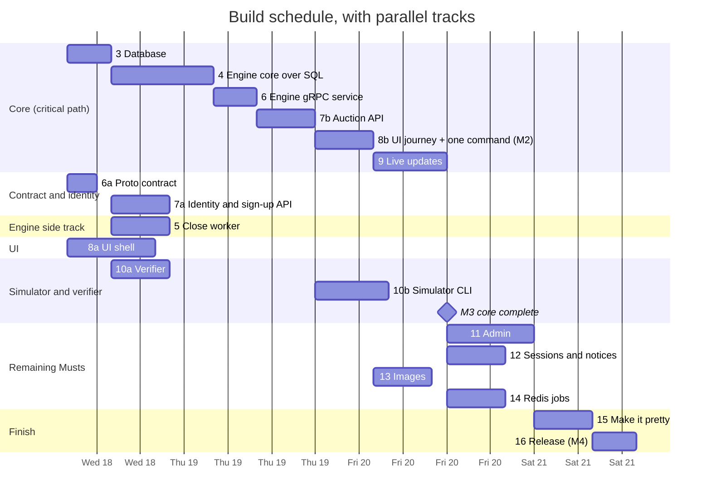

# Build plan

The route from the spec to a working, tested platform by the target release (2026-11-23).

## Approach

- **Ground up, in test order.** Each step adds one layer on top of the last: rules, database, engine, engine service, API, UI, live updates. Each step's tests use the layers below for real; nothing is mocked out.
- **A step starts only when the steps it depends on are proven** (see the dependency table). A step is done when its own tests pass, the whole suite still passes, CI is green, and its demo check shows the expected result.
- **Working before pretty.** Behaviour has to be right from the first step; layout and styling wait until step 15.
- **A runnable prototype exists from step 8 on.** Every later step adds to something that already starts with one command.
- **Core requirements first, hosting last.** The architecture and the bid flow are in [architecture.md](architecture.md).

## Dependencies and parallel tracks

Some steps split in two: a part that only needs lower layers, which can start early, and a part that needs the layer above it. The split parts are marked a and b.

| Step | Depends on (must be proven first) | Can run alongside | Touches |
|---|---|---|---|
| 3 Database | 1 | 6a, 8a | `src/Auction.Migrator`, `deploy/` |
| 6a Proto contract (`auction.v1`, Buf checks) | 2 | 3, 8a | `src/Auction.Contracts` |
| 8a UI shell (layout, routing, sign-in and empty pages, no data yet) | 1 | 3, 6a, 4, 5 | `src/Auction.Web` |
| 4 Engine core over SQL | 2, 3 | 5, 7a, verifier, 8a | `src/Auction.Engine` (data access, commands) |
| 5 Close worker | 2, 3 | 4, 7a, verifier | `src/Auction.Engine` (worker only) |
| 7a Identity and sign-up API | 3 | 4, 5, verifier | `src/Auction.Api` (auth) |
| 10a Verifier | 2, 3 | 4, 5, 6, 7 | `src/Auction.Verifier` |
| 6 Engine gRPC service | 4, 5, 6a | 7a | `src/Auction.Engine` (host) |
| 7b Auction API | 6, 7a | 10b | `src/Auction.Api` (auctions) |
| 8b UI journey and one-command run | 7b, 8a | 10b | `src/Auction.Web`, `deploy/compose.yaml` |
| 10b Simulator CLI | 7b | 8b, 9 | `src/Auction.Simulator` |
| 9 Live updates | 4 (outbox), 8b | 10b, 13 | `src/Auction.Api` (relay, hub), `src/Auction.Web` (client store) |
| **M3** | 8b, 9, 10a, 10b | | hot-burst run with the verifier |
| 11 Admin | 9 | 12, 13 | `src/Auction.Web` (Admin area), `src/Auction.Api` (admin) |
| 12 Sessions and notices | 9 | 11, 13 | `src/Auction.Api` (auth, notices), bell component |
| 13 Images | 6, 7b, 8b | 9, 11, 12 | engine attach, API blobs, sell form |
| 14 Redis jobs | 9 | 15 | `src/Auction.Api` (cache, limits) |
| 15 Make it pretty | 11, 12, 13 | 14 | `src/Auction.Web` (all pages) |
| 16 Release | everything above | — | docs, quickstart |

**The critical path** (the longest chain, which sets the finish date): 3 → 4 → 6 → 7b → 8b → 9 → 11 → 15 → 16. With the hour estimates in the chart below (estimates, not measurements), all the steps add up to about **158 hours** of work done one at a time, while the critical path is about **78 hours**. Running the independent tracks alongside roughly halves the elapsed time.

**Parallel work:** independent steps run on their own short-lived branches, each touching only the folders in its "Touches" column, with at most three in flight. Shared files (`Auction.slnx`, `Directory.Packages.props`, `deploy/compose.yaml`) change on one branch at a time, and a branch merges only when the full suite passes on `main` after the merge.

The chart counts hours of active work, not calendar time, so a 14-hour step runs across more than one working day. If a bar on the critical path slips, the finish slips with it. A bar off the critical path can slip until it delays something that depends on it.

## Every step, the same loop

1. Write failing tests at the layer this step adds, and commit them.
2. Make them pass, then refactor, and commit.
3. Run the gates: locked restore, format check, Release build with zero warnings, the full test suite.
4. Update the traceability table in [requirements](requirements.md) §10.
5. Push, confirm CI is green, and run the step's demo check.

At each milestone (M1–M3), an independent requirements audit checks that milestone's steps; any finding is fixed and re-checked before the next step starts. The release (M4) gets a full audit.

## The ladder

| Step | Builds | Gate: tests that must pass | Demo check | What it proves | Requirements | Target |
|---|---|---|---|---|---|---|
| 1 | Toolchain, CI, real-PostgreSQL test harness | Locked restore, zero-warning build, 2 database tests | `dotnet test` passes; CI green | The project builds the same everywhere | FND-01, TST-01 (partial) | done 11-16 |
| 2 | **Domain rules** in `Auction.Domain`: money, proxy and fixed-increment bidding, reserve, deadline, listing checks, lifecycle | 88 unit and property tests (2,000 random auctions each, checked against the reference model) | `dotnet test --project tests/Auction.UnitTests` passes | The auction rules are right before any storage exists | DOM-01..03, BID-01, LIF-01 (U); SIM-03 reference model | done 11-17 |
| 3 | **Database:** tables, the four roles and grants, append-only trigger on bids, amount checks, one-shot migrator in Compose | Migrations apply to an empty PostgreSQL 18; each role can do exactly its grants and nothing more; bids can't be updated or deleted; out-of-range amounts are refused by the database | `docker compose up migrator` exits 0; the role tests pass | The data can't be corrupted, even by our own services | SEC-05, COR-05 (D), DOM-01 (D), OPS-01 | 11-18 |
| 4 | **Engine core over SQL**, not yet a service: create, publish, cancel and bid, each one locked transaction using the step-2 rules, `clock_timestamp()` after the lock, idempotency records, outbox row | 50 bidders racing on one auction keep every invariant and agree with the reference model; a bid that waited on the lock past the end is refused; a repeated key replays the first result | The engine integration tests pass | Concurrent bidding is correct in the real database | COR-01..05, DOM-02/03 (D), BID-01 (D), REL-01 | 11-18 → 19 |
| 5 | **Close worker:** activates Scheduled auctions and closes due ones with Sold / Reserve not met / No bids | Closes at the right time with the right outcome; running it twice, or two workers at once, changes nothing | Close-worker tests pass | Auctions end correctly on their own | LIF-01 (D) | 11-19 |
| 6 | **Engine as a gRPC service** in Compose: `auction.v1` proto with Buf checks, health probe, actor taken from the caller | A real gRPC client places bids against the engine container; the step-4 race test passes over gRPC | `docker compose up engine` reports healthy | The engine is a separate service and the only writer of auction state | FND-02, COR-01 (S) | 11-19 |
| **M1** | **Engine proven:** independent requirements audit of steps 2–6 | | | | | 11-19 |
| 7 | **API:** sign-up and email sign-in (`DEMO_MODE`), cookie auth, auction list and detail, create, publish, cancel and bid through the engine, Problem Details, Origin check | HTTP tests for the whole journey plus the core §7 rows: anonymous 401, another user's draft 404, self-bid refused | A `.http` file: sign up, list an item, bid from a second user, read the price | Anyone can use the platform over HTTP | API-01, API-03, SEC-01, SEC-04 (core rows), AUTH-01 | 11-19 → 20 |
| 8 | **Ugly UI and one command:** bare Blazor + MudBlazor pages for sign-in, directory, detail with a bid box, sell form and my bids; `docker compose up` runs everything; README "Run it"; a CI job that clones fresh, runs the one command and the full suite | Browser test: a seller lists, a buyer bids, both see the new price after a reload | **Run one command, open the browser, do the journey** | **M2: a working prototype** | UI-01 (basic), INT-01, INT-04 | 11-20 |
| 9 | **Live updates:** outbox relay, SignalR hub with Redis backplane, version-gated client refresh, re-fetch on reconnect, on tab focus and every 10 s | Two browsers converge within 2 s; with Redis stopped, within 10 s; an older update never overwrites a newer one | Two browser windows, bid in one, watch the other | Every open interface stays consistent | OUT-01, RT-01, RT-02, INT-02, REL-02 (backplane) | 11-20 |
| 10 | **Simulator and verifier:** CLI virtual users (smoke, realistic, hot-burst) over the public API; read-only verifier using the reference model | Hot burst (50 bidders × 30 s): zero invariant violations; realistic profile: bid p95 recorded | One command runs a profile and prints the verifier report | **M3: core requirements complete (INT-01–04)** | SIM-01..05, SIM-16, SIM-03, INT-03 | 11-21 |
| 11 | **Admin view:** live activity, health, latency KPIs, suspend, resume and cancel with a reason, disable a user, start or stop a simulator profile | Admin actions and their §7 rows; KPIs show "not measured" with no traffic | Run the simulator and watch the admin page | The third interface works | UI-04, ADM-01, ADM-02 | 11-21 |
| 12 | **Accounts and notices:** single active session, notification bell, rate limits | A second sign-in ends the first session; outbid and closing notices reach only the right users; limits return 429 | Sign in twice; get outbid | Accounts behave safely | AUTH-02, NOT-01, rate-limit rows | 11-22 |
| 13 | **Images** | UI-05 acceptance | Upload a photo and see it in the directory | Listings look like listings | UI-05 | 11-22 |
| 14 | **Redis jobs:** read cache, ending-soon index, presence, shared rate limits, session cache; Redis-down behaviour | REL-02 acceptance | Stop Redis and keep bidding | Redis speeds things up but never decides | REL-02, UI-03 (index), TST-01 (Redis) | 11-22 |
| 15 | **Make it pretty:** MudBlazor layout, every page state, 360 px, axe checks | Zero serious axe violations; page-state tests | Look at it on a phone width | It looks finished | UI-01, UI-03 | 11-22 |
| 16 | **Release:** clean-clone quickstart, README, demo guide, known limitations; supply-chain CI (gitleaks secret scan, Trivy image scan, Dependabot, build provenance and SBOM attestations) | The quickstart works from a fresh clone; a full requirements audit passes | Clone fresh and run the one command | **M4: the release** | INT-04, DEL-01, HOST-01 | 11-22 |
| stretch | Second API instance behind a load balancer | RT-03 acceptance | | | RT-03, SEC-03 | if time |
| last | Hosting at `/projects/ebay` | | | | HOST-02 | once hosting is confirmed |

**Shoulds and Coulds** fold into the step they touch, and only when that step's Musts are already green.

## What's built

Every step's state, with the evidence behind it. The [traceability table](requirements.md) has the same per requirement.

| Layer | State |
|---|---|
| Toolchain and CI: pinned SDK, locked packages, zero-warning build, real-PostgreSQL tests | Built; CI green |
| Auction rules: money, proxy and fixed-increment bidding, reserve, deadlines, listing validation, lifecycle | Built and unit-tested (88 tests) |
| Database: schema, four least-privilege roles, append-only bids, amount and lifecycle constraints, one-shot migrator | Built and tested against PostgreSQL 18 |
| Engine core: create, edit, publish, cancel and bid, each one locked transaction with idempotency and an outbox event | Built and tested against PostgreSQL 18, including 50-bidder races checked against the reference model |
| Close worker: starts scheduled auctions, closes ended ones with Sold, Reserve not met or No bids, and deletes idempotency records after 24 hours | Built and tested, including two workers sweeping at once |
| Engine service: the `auction.v1` gRPC contract, health probe, correlated JSON logs, internal-only in Compose | Built and tested from its container image, including the 50-bidder races over gRPC |
| API: sign-up and email sign-in, cookie sessions, auction list, detail and bid history, and create, edit, publish, cancel and bid through the engine, with Problem Details, cross-site checks and an OpenAPI document | Built and tested over HTTP against the engine container |
| Web client: Blazor WebAssembly and MudBlazor pages for sign-in, the directory, an auction with its bid box and history, selling (drafts, publish, cancel) and my bids, served by the API from the same origin | Built and tested in a real browser (Playwright) against the whole stack; plain styling until build step 15 |
| One-command run with generated secrets and demo seed data | Built; CI runs it on every push from a fresh clone |
| Live updates: outbox relay in commit order, SignalR hints through a Redis backplane, version-gated views that reconcile every 10 s | Built and tested: four browsers converge within 2 s; with Redis stopped, bids still work and views heal |
| Simulator and verifier: virtual users over the public API (smoke, realistic and hot-burst profiles) and a read-only checker that recomputes every auction with a naive reference model | Built and tested: 50 bidders on one auction for 30 seconds with zero invariant violations |
| Admin area: live activity, system health, latency KPIs over a rolling five minutes, auction moderation (suspend, resume, cancel with a reason), user disable/enable, starting and stopping a simulator run, and a searchable audit log of every admin action | Built and tested in the browser and over HTTP |
| Accounts: one active session per account (signing in elsewhere ends the others, and an open page is told at once), a live notification bell, and sign-in, sign-up and write rate limits | Built and tested in the browser and over HTTP |
| Images: up to four JPEG, PNG or WebP per listing, checked by file signature and size, stored in PostgreSQL, linked by the engine under the auction lock, frozen at publish, with race-free quotas and an hourly sweep | Built and tested, including racing attaches and quota races |
| Redis jobs: a version-checked read cache for auctions and the directory, the session-validity cache, shared rate-limit counters and presence across instances, with PostgreSQL or local fallbacks; directory search and status filters | Built and tested, including two API instances sharing limits and presence, and a Redis outage |
| Design: a themed MudBlazor layout, a card directory with cover images, shared loading, empty, error (with retry) and sign-in states, usable at 360 px | Built and tested: zero serious or critical axe violations on the main pages, no sideways scrolling at 360 px |
| Release: liveness and readiness, a path base and trusted proxies for hosting, reset-demo, and supply-chain checks in CI (gitleaks, Trivy, SBOMs with provenance, Dependabot) | Built and tested; the release tag is the owner's to create |
| Observability: OpenTelemetry traces, metrics and logs from the API and engine over OTLP, with the standalone Aspire dashboard in an optional Compose profile | Built and tested: a bid's trace runs from the API request through the engine's transaction to its queries |
| Live demo: an always-on marketplace of simulated sellers and bidders with free photos, a choice of User or Admin at sign-up, and a daily and on-demand reset | Built and tested: listings with photos within minutes, bids on visitors' listings, recovery after cancellations, disabled accounts and resets |

## If the deadline is at risk

Check progress at the end of each day against the Target column. Nothing below M3 is cut: steps 1–10 are the core requirements and the correctness that makes them true. If a step slips by more than half a day, cut from the top of the ladder down. Moving a Must to Should is a recorded decision.

1. **Coulds and Shoulds** not yet started (LOC-01, ADM-03, OBS-01, step 17), each moved to "With more time".
2. **Step 15** reduced to page states and axe; the visual polish goes.
3. **Step 14** reduced to rate limits and the session cache.
4. **Step 13** reduced to one image per auction.
5. **Step 11:** keep activity, health and suspend; the KPIs and simulator start/stop go (the CLI still runs the simulator).
6. **Step 12:** keep the single session and the notification bell; the extra limits go.

Never cut: steps 1–10, the browser-layer acceptance of the Musts, and step 16. A prototype that works and is ugly beats a pretty one that doesn't.
